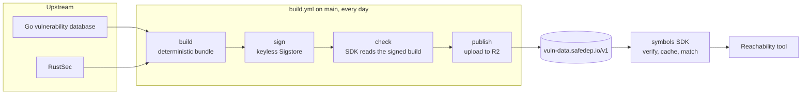

# vuln-symbols

An open database of vulnerable functions, in [OSV](https://ossf.github.io/osv-schema/) format.

A vulnerability advisory names a package and a range of versions. It seldom names the functions that
hold the vulnerable code. A reachability tool needs those functions. With them, it can tell "the
project calls the vulnerable code" from "the project only installs the package".

vuln-symbols publishes these functions as a signed bundle that any tool can download and verify.

## Status

Public preview. The formats can change until the first alpha release.

| Part | State |
| --- | --- |
| Upstream records from the Go vulnerability database and RustSec | Published every day |
| Signed bundle and the Go SDK in [`symbols/`](symbols) | Available |
| Community records for npm, PyPI, Maven and other ecosystems | Planned. The record format and the verification rules are drafts. |
| `vsym candidates`, `vsym derive` and `vsym verify` | Planned |

In October 2026 the bundle held about 930 Go advisories and 290 RustSec advisories.

## What a record holds

A record is an OSV document with one extension, `affected[].database_specific.vuln_symbols`. The
extension lists the fix sites, the functions that hold the vulnerable code.

```json
{
  "id": "GO-2020-0001",
  "aliases": ["CVE-2020-36567", "GHSA-6vm3-jj99-7229"],
  "affected": [{
    "package": { "ecosystem": "Go", "name": "github.com/gin-gonic/gin" },
    "database_specific": { "vuln_symbols": {
      "coverage": "exact",
      "fix_sites": [
        { "name": "github.com/gin-gonic/gin.Default" },
        { "name": "github.com/gin-gonic/gin.Logger" }
      ]
    } }
  }]
}
```

`coverage` tells a consumer how far to trust the list:

- `exact`: the list is complete. A tool can say "not called" when the project calls none of the fix
  sites.
- `broad`: the list can be incomplete. A tool can say "called" from it, but never "not called".

All RustSec entries are `broad`, because RustSec does not promise a complete function list.

[docs/spec/record.md](docs/spec/record.md) holds the full format.

## Architecture



1. **Build.** The builder reads the OSV exports of each upstream database and makes one record per
   advisory. It writes the records as gzip JSON lines, sorted by id. The same exports always give
   the same bytes. The manifest names the SHA-256 of the bundle file, the SHA-256 of its content and
   the record count.
2. **Sign.** A separate job signs the manifest with [Sigstore](https://www.sigstore.dev/) keyless
   signing. The job gets a GitHub OIDC token. Fulcio gives a short-lived certificate for the identity
   of the workflow. The signature goes into the public Rekor transparency log. No signing key exists
   to steal. The sign job has the OIDC right only, and it runs no code of this repository.
3. **Check.** Before the upload, the SDK reads the signed build as a consumer does. A bundle that no
   client would accept stops here.
4. **Publish.** The job uploads the files to R2. A bundle and its signed manifest are immutable and
   named by the bundle hash. Only `manifest.json` and its signature change.

The manifest holds the hashes of the bundle, so one signature covers every record.

### What a client verifies

The SDK accepts a bundle only when all of these hold:

- The signature is valid for the manifest bytes.
- The certificate has the issuer `https://token.actions.githubusercontent.com` and the identity
  `https://github.com/safedep/vuln-symbols/.github/workflows/build.yml@refs/heads/main`. A signature
  from a fork, from another branch or from another workflow fails.
- The signature has a certificate timestamp, a transparency log entry and a verified time.
- The bundle has the size, the file hash, the content hash and the record count of the manifest.
- The verified signing time is not older than the signing time of the cached bundle. This stops a
  host from serving an old bundle.

The SDK keeps its cached bundle when the host is down or a check fails. It asks the host at most once
a day, with an ETag. [docs/spec/bundle.md](docs/spec/bundle.md) holds the full rules.

## Use the bundle from Go

```bash
go get github.com/safedep/vuln-symbols@main
```

```go
import (
	packagev1 "buf.build/gen/go/safedep/api/protocolbuffers/go/safedep/messages/package/v1"
	"github.com/safedep/dry/api/pb"
	"github.com/safedep/vuln-symbols/symbols"
)
```

```go
c, err := symbols.New(symbols.WithCacheDir(filepath.Join(cache, "vuln-symbols")))
if err != nil {
	return err
}
// Update asks the host at most once a day. It keeps the cached bundle
// when the host is down or a check fails.
if _, err := c.Update(ctx); err != nil {
	log.Printf("update: %v", err)
}
b, err := c.Load(ctx)
if err != nil {
	return err
}

pv := pb.NewPackageVersionFromParts(packagev1.Ecosystem_ECOSYSTEM_GO, "github.com/gin-gonic/gin", "v1.5.0")
for _, a := range b.Lookup(symbols.Query{Package: pv, IDs: []string{"CVE-2020-36567"}}) {
	vs := a.Affected.DatabaseSpecific.VulnSymbols
	fmt.Println(a.Record.ID, vs.Coverage, a.Affected.Names())
}
```

`pb` is [`github.com/safedep/dry/api/pb`](https://github.com/safedep/dry). A query matches a record by
any id of its alias set, by the package name and by the affected version range.

Other options:

| Option | Use |
| --- | --- |
| `WithPin(sha256)` | Keep the client on one bundle. |
| `WithLocalBundle(dir)` | Read a copy of the host files from a directory, with no network. The client still checks the signature. |
| `WithTrustedRoot(path)` | Read the Sigstore trusted root from a file in place of TUF, for a machine with no network. |
| `WithOffline()` | Read the cache only. |

`Bundle.Info().SignedAt` gives the signing time. Warn your users when it is old. A host that stops
publishing looks the same as a database with no new advisories.

## Use the bundle without Go

Verify the manifest with [cosign](https://github.com/sigstore/cosign) v3, and then check the bundle
against it.

```bash
base=https://vuln-data.safedep.io/v1
curl -fsSO $base/manifest.json
curl -fsSO $base/manifest.sigstore.json

cosign verify-blob manifest.json \
  --bundle manifest.sigstore.json \
  --certificate-oidc-issuer https://token.actions.githubusercontent.com \
  --certificate-identity https://github.com/safedep/vuln-symbols/.github/workflows/build.yml@refs/heads/main

sha=$(jq -r .bundle.sha256 manifest.json)
curl -fsSO "$base/bundles/$sha.jsonl.gz"
echo "$sha  $sha.jsonl.gz" | sha256sum -c -
gzip -dc "$sha.jsonl.gz" | head -1 | jq .
```

## Data licenses

The code is Apache-2.0. Each record keeps the license of its source, in
`database_specific.license`. The manifest names the license and the attribution of each source.

| Source | License |
| --- | --- |
| [Go vulnerability database](https://vuln.go.dev), by the Go Authors | CC-BY-4.0 |
| [RustSec advisory database](https://rustsec.org) | CC0-1.0 |

The license of community records is not decided yet. See [NOTICE](NOTICE).

## Documentation

- [docs/spec/record.md](docs/spec/record.md): the record format
- [docs/spec/verification.md](docs/spec/verification.md): the checks that a community record must
  pass
- [docs/spec/bundle.md](docs/spec/bundle.md): the bundle, the manifest, the signature and the client
  rules
- [docs/glossary.md](docs/glossary.md): the terms

## Contributing

See [CONTRIBUTING.md](CONTRIBUTING.md). Agents read [AGENTS.md](AGENTS.md).

To report a security problem, see [SECURITY.md](SECURITY.md).

## License

Apache-2.0. See [LICENSE](LICENSE).
